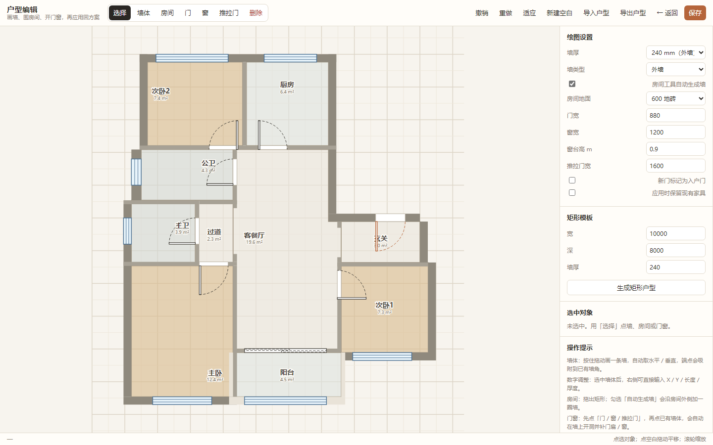
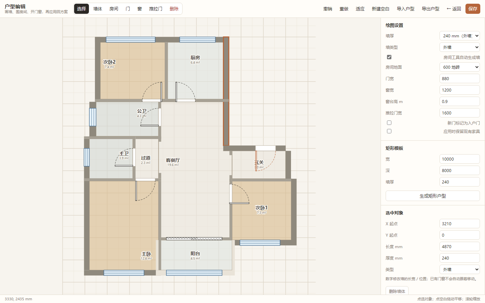
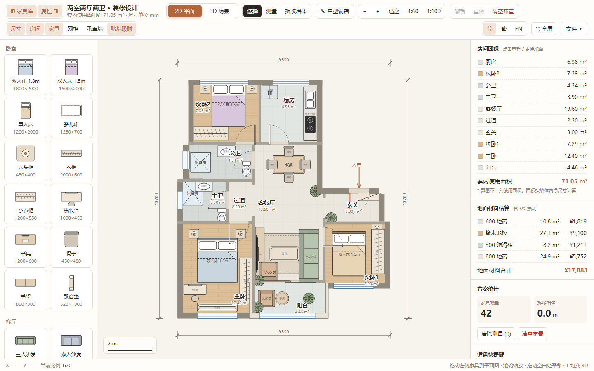
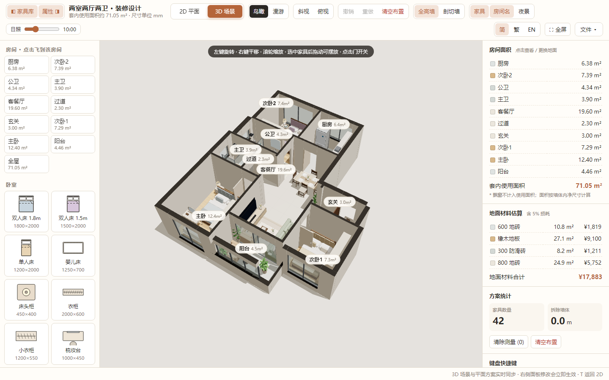

# 户型装修设计

中文 | [English](README.en.md)

纯前端的户型装修设计工具：在 2D 平面图上摆放家具、拆改墙体、测量尺寸，一键切换到 Three.js 3D 场景，可以鸟瞰，也可以第一人称漫游。整个应用就是一个 `index.html`，无需构建，打开即用。

## 功能

**2D 平面布置**
- 顶栏「✎ 户型编辑」：画墙、拖出房间、点墙开门窗，新建空白户型或一键生成矩形模板
- 选中墙体后可输入 X / Y / 长度 / 厚度精确调整；编辑器提供「← 返回」和「保存」
- 保存户型后自动重建 2D / 3D、面积统计和尺寸标注，户型保存在浏览器本地，刷新不丢
- 支持户型 JSON 导入 / 导出，方便备份和换电脑
- 支持 1:60 / 1:100 比例显示，尺寸单位 mm
- 从左侧家具库拖入 60 余种家具家电（卧室、客厅、餐厨、卫浴、家电、书房休闲）
- 拖动移动、旋转（Shift 自由角度）、调整尺寸，贴墙自动吸附
- 测量工具（靠近墙面自动吸附，Shift 锁定水平 / 垂直）
- 拆改非承重墙，承重墙单独标示
- 图层开关：尺寸标注、房间名、家具、网格、承重墙

**3D 场景**
- 鸟瞰、斜视、俯视多种视角，点击房间列表可飞到对应房间
- 漫游模式：桌面端 WASD + 鼠标，触屏设备用虚拟摇杆，可以点门开关
- 全高墙 / 剖切墙切换，日照时间滑块，夜景灯光
- 精细家具模型：柜门分缝与拉手、软包床头、带环境反射的金属与陶瓷材质等
- 在 3D 中也能选中、拖动家具，与 2D 方案实时同步

**方案与统计**
- 房间面积与套内使用面积自动统计
- 为每个房间更换地面材料（木地板、地砖、大理石、水磨石、地毯等），按面积加 5% 损耗估算造价
- 撤销 / 重做，方案自动保存在浏览器本地
- 中文 / English 界面切换（顶栏右侧按钮，默认中文，选择会记住）
- 导出 PNG 图片，导出 / 导入方案 JSON

## 快速开始

```bash
git clone <仓库地址>
cd <仓库目录>
```

然后直接用浏览器打开 `index.html`。也可以起一个本地静态服务器：

```bash
python3 -m http.server 8000
# 访问 http://localhost:8000
```

> Three.js 通过 jsDelivr CDN 加载，首次打开 3D 场景需要联网。

## 快捷键

| 按键 | 作用 |
| --- | --- |
| `T` | 切换 2D / 3D |
| `V` / `M` / `X` | 选择 / 测量 / 拆改墙体 |
| `R` / `Shift+R` | 选中家具顺时针 / 逆时针旋转 90° |
| `Delete` / `Backspace` | 删除选中家具 |
| `Ctrl/⌘ + D` | 复制选中家具 |
| `Ctrl/⌘ + Z`，`Ctrl/⌘ + Shift + Z` | 撤销，重做 |
| `F` | 适应窗口 |
| `+` / `-` | 放大 / 缩小 |
| `[` / `]` | 展开 / 收起左侧家具库、右侧面板 |
| `Shift + F` | 全屏 |
| `Esc` | 取消当前操作 |
| 漫游：`WASD` / 方向键，`Shift`，`E` | 移动，快走，开关门 |

## 技术栈

- 原生 HTML / CSS / JavaScript，无框架、无构建步骤
- 2D 平面图用 SVG 绘制
- 3D 场景用 [Three.js](https://threejs.org/) r160（OrbitControls、PointerLockControls、RoundedBoxGeometry、RoomEnvironment、CSS2DRenderer）
- 数据保存在 `localStorage`

## 自定义户型

最直接的方式：点顶栏的 **「✎ 户型编辑」**，用「墙体 / 房间 / 门 / 窗 / 推拉门」工具画自己的户型，支持新建空白、矩形模板、撤销重做、导入 / 导出户型 JSON。选中墙体后可以直接输入 X / Y / 长度 / 厚度；改完点「保存」会重建 2D / 3D、面积和尺寸标注，点「← 返回」放弃修改回到主界面。之后就可以直接拖家具进来。自定义户型保存在浏览器 `localStorage`，刷新不丢。

> 当前内置户型按你提供的镜像户型图方向布置。

底层数据仍然写在 `index.html` 里，适合批量 / 精确修改：

- `ROOMS`：房间多边形、名称、默认地面材料
- `WALLS` / `WINS` / `DOORS` / `SLIDES` / `BAYS`：墙体、窗、门、推拉门、飘窗洞口
- `MATS`：地面材料名称与单价
- `LIB`：家具库（类型、名称、默认尺寸、颜色）
- `buildFurniture()`：各类家具的 3D 模型

更详细的坐标规则、门窗写法、完整替换示例和「换户型必须同步修改的硬编码清单」，见 [CUSTOMIZE.md](CUSTOMIZE.md)。

## 户型编辑器截图









## 社交媒体

- X（Twitter）：[@akokoi1](https://x.com/akokoi1)

## 许可协议

[MIT](LICENSE)
